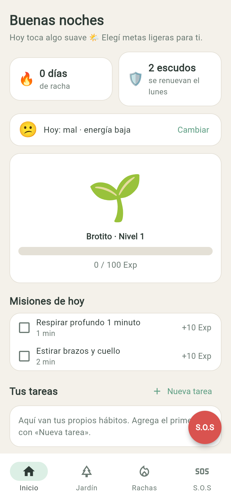
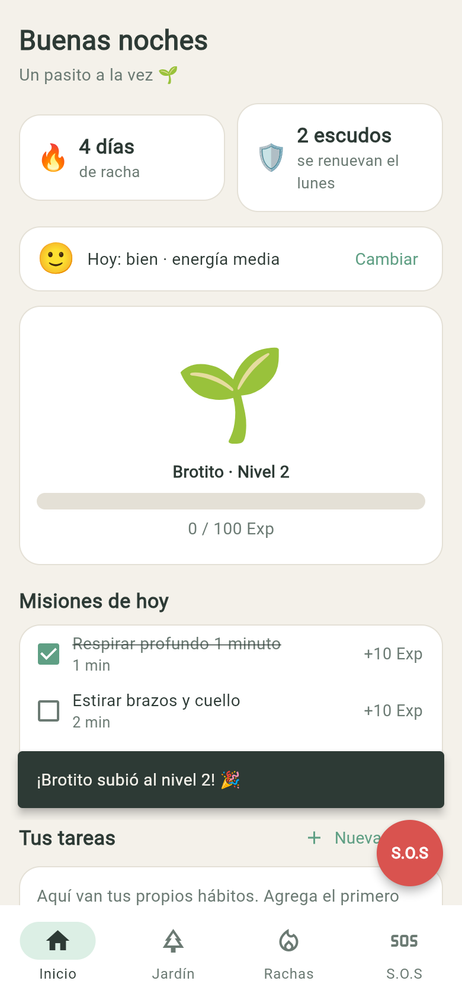
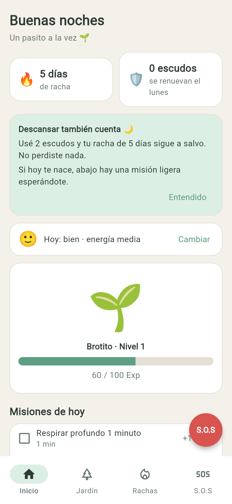

# Brota

Rutinas gamificadas que no castigan el fallo. App de hábitos para personas con procrastinación, aislamiento o depresión: Brotito, la planta-mascota, crece contigo, y si un día no puedes con nada, tu racha se protege sin culpa.

Proyecto de Proyectos I+D I (BUAP) — Equipo 1.

| Ánimo y metas | Completar actividad | Racha protegida | S.O.S. |
|---|---|---|---|
|  |  |  |  |

## Sistema implementado (CU-01 a CU-24)

| CU | Nombre | RF |
|---|---|---|
| CU-01 | Registrarse (hash con sal, rol, fecha de nacimiento obligatoria, aviso de privacidad y consentimiento parental de 13 a 17 años) | RF-01 |
| CU-02 | Iniciar sesión (modo invitado disponible) | RF-01 |
| CU-03 | Personalizar avatar | RF-02 |
| CU-04 | Elegir mascota de compañía y nombrarla | RF-03 |
| CU-05 / 05a | Registrar estado de ánimo diario / ajustar metas | RF-04 |
| CU-06 | Explorar catálogo de microactividades | RF-05 |
| CU-07 / 07a | Crear tarea personalizada (categoría y esfuerzo) | RF-06 |
| CU-08 | Configurar recordatorios amigables (notificaciones locales en Android) | RF-07 |
| CU-09 / 09a / 09b | Completar actividad, otorgar XP y semillas, subir de nivel (avatar cada 100 Exp, mascota cada 150 Exp) | RF-08 |
| CU-10 | Proteger racha flexible (1 escudo por semana) | RF-09 |
| CU-11 | Consultar recursos de ayuda | RF-10 |
| CU-12 | Ver mensajes motivacionales (estilo implícito) | RF-11 |
| CU-13 | Botón S.O.S. emocional (911, Línea de la Vida, contactos) | RF-12 |
| CU-14 | Compartir logros y aliento (solo frases predefinidas) | RF-13 |
| CU-15 | Consultar panel de progreso | RF-14 |
| CU-16 | Ver resumen semanal | RF-15 |
| CU-17 | Exportar historial a PDF (≤ 2 MB) | RF-16 |
| CU-18 | Administrar catálogo de microactividades | RF-05 |
| CU-19 / 19a | Administrar mensajes validados y directorio / clasificar la frase con el diccionario | RF-10, RF-11 |
| CU-20 | Predecir riesgo de procrastinación y simplificar misiones (perceptrón) | RF-04, RF-08 |
| CU-21 | Reaccionar al compañero fantasma | RF-13 |
| CU-22 | Comprar decoraciones en la tienda del jardín | RF-08 |
| CU-23 | Reportar una publicación del muro | RF-13 |
| CU-24 | Moderar reportes (Administrador) | RF-13 |

## Características

- **Perceptrón predictor de riesgo** (`lib/logic/perceptron.dart`): 8 entradas normalizadas (constancia de 7 días, hora media de cumplimiento, escudos de la semana, fin de semana, interacciones con el compañero fantasma, último ánimo y energía, actividad de hoy), suma ponderada + sesgo → ALTO/BAJO. Aprende en el dispositivo con la regla del perceptrón (η = 0.1) al cerrar cada día. Si el riesgo es ALTO, las misiones del día siguiente son solo ligeras. No diagnostica nada: solo adapta la dificultad. Pantalla «Cómo decide Brota» con entradas, pesos y sesgo. Los pesos iniciales son una propuesta del equipo.
- **Diccionario de palabras clave** (`docs/diccionario_motivacional.json`, el mismo que usa el backend): clasifica una frase como motivadora, neutra, no apta o de riesgo, y su estilo como implícito o explícito. El Administrador solo puede guardar mensajes motivadores.
- **Mensajes motivacionales implícitos**: los textos describen lo que pasó («Brotito estiró sus hojas», «Descansar también cuenta») en lugar de dar órdenes o evaluar a la persona.
- **Compañero fantasma anónimo**: «alguien en el mundo completó su misión de hoy» con 3 reacciones predefinidas. Con servidor es real; sin servidor la app muestra señales de ejemplo y lo indica en pantalla.
- **Mascota con estados de ánimo** (feliz / somnolienta con 1 día sin actividad / triste con 2 o más) que nunca muere ni pierde nivel.
- **Tienda del jardín**: 10 decoraciones que se compran con semillas (1 por Exp); comprar no baja el nivel; sin micropagos.
- **Comunidad moderada**: solo frases predefinidas, botón «Reportar» y revisión del Administrador.
- Funciona sin conexión: el estado se guarda **cifrado** en el dispositivo (`shared_preferences` + HMAC-SHA256).
- **Servidor opcional** ([Backend-Brota](https://github.com/DarvoDev/Backend-Brota), FastAPI + PostgreSQL en Docker): JWT, sincronización de la cola local con UUID por evento (reenviar no duplica, RNF-07), compañero fantasma real y muro compartido. Más → «Servidor y sincronización».
- Android 8+ (minSdk 26) y web con un solo código Flutter. iOS queda como trabajo futuro (requiere Mac).
- PDF del historial generado localmente, sin dependencias externas.

## Estructura

```
lib/
  main.dart               arranque, navegación, botón S.O.S. global
  theme.dart              paleta y componentes
  models/modelos.dart     clases del dominio (diagrama de clases v1 + ampliaciones)
  data/catalogo.dart      catálogo, ayuda, mensajes, frases del muro y tienda
  logic/perceptron.dart   perceptrón de riesgo (Dart puro)
  logic/clasificador.dart diccionario de palabras clave (+ diccionario.g.dart)
  state/brota_state.dart  lógica de los 24 casos de uso
  services/               almacén, cifrado, PDF, API del servidor y notificaciones
  screens/                inicio, jardín, rachas, S.O.S., más, perfil,
                          catálogo, recordatorios, ayuda, motivación,
                          comunidad, progreso, resumen, administración,
                          riesgo (perceptrón) y servidor
test/                     pruebas unitarias, de widget y de aceptación
docs/evidencias/          capturas de la ejecución de las pruebas
```

## Ejecutar

```
flutter pub get
flutter run -d chrome   # navegador
flutter run             # teléfono Android conectado
flutter test            # pruebas

# Opcional, prueba contra el servidor real (Backend-Brota en Docker):
BROTA_API=http://localhost:8000 flutter test test/e2e_backend_test.dart
```

### APK para repartir (con el servidor ya configurado)

```
flutter build apk --release --dart-define=BROTA_SERVIDOR=https://brota.midominio.com
```

Con `BROTA_SERVIDOR` la pantalla Más → Servidor y sincronización ya no pide dirección: solo la contraseña y «Conectar» (queda «Usar otro servidor» por si acaso). Debe ser HTTPS con certificado válido (Let's Encrypt en Backend-Brota: `BROTA_TLS=<correo>`); Android bloquea HTTP y certificados autofirmados.

Para usar el servidor desde el emulador Android: en Backend-Brota `docker compose up -d --build`, y en la app Más → Servidor y sincronización → `http://10.0.2.2:8000`. HTTP sin cifrar solo se permite hacia el emulador y localhost (`res/xml/network_security_config.xml`); en producción, HTTPS.

> Brota acompaña, pero no sustituye la atención profesional. En una emergencia en México llama al 911 o a la Línea de la Vida: 800 911 2000.
