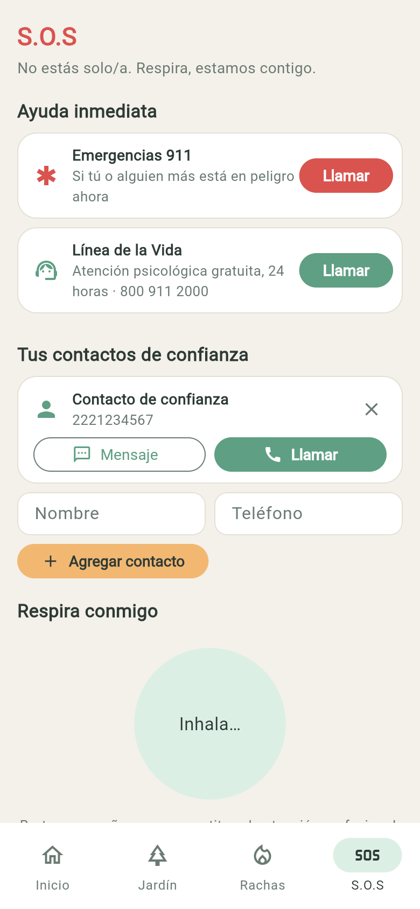

# Brota

Rutinas gamificadas que no castigan el fallo. App de hábitos para personas con procrastinación, aislamiento o depresión: Brotito, la planta-mascota, crece contigo, y si un día no puedes con nada, tu racha se protege sin culpa.

Proyecto de Proyectos I+D I (BUAP) — Equipo 1.

| Ánimo y metas | Completar actividad | Racha protegida | S.O.S. |
|---|---|---|---|
|  |  |  |  |

## Casos de uso implementados

| CU | Nombre |
|---|---|
| CU-05 | Registrar estado de ánimo diario (ajusta las metas del día) |
| CU-07 | Crear tarea personalizada (categoría y nivel de esfuerzo) |
| CU-09 | Completar actividad (otorga XP y sube de nivel) |
| CU-10 | Proteger racha flexible (escudos / congelamientos) |
| CU-13 | Botón S.O.S. emocional (911, Línea de la Vida, contactos de confianza) |

## Características

- Funciona sin conexión: los datos se guardan en el dispositivo (`shared_preferences`).
- Android y web con un solo código Flutter.
- Sin IA: las metas se ajustan con reglas simples según ánimo y energía.

## Estructura

```
lib/
  main.dart               arranque, navegación, botón S.O.S. global
  theme.dart              paleta y componentes
  models/modelos.dart     clases del dominio (diagrama de clases v1)
  data/catalogo.dart      catálogo de microactividades y directorio de ayuda
  state/brota_state.dart  lógica de los casos de uso
  services/almacen.dart   guardado local
  screens/                inicio, jardín, rachas, S.O.S., ánimo, nueva tarea
test/widget_test.dart     17 pruebas
```

## Ejecutar

```
flutter pub get
flutter run -d chrome   # navegador
flutter run             # teléfono Android conectado
flutter test            # pruebas
```

> Brota acompaña, pero no sustituye la atención profesional. En una emergencia en México llama al 911 o a la Línea de la Vida: 800 911 2000.
